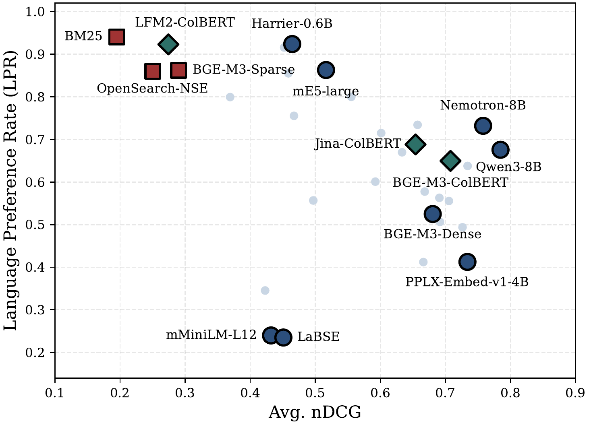

<div align="center">

# MLAIRE

### MLAIRE: Multilingual Language-Aware Information Retrieval Evaluation Protocol

[](https://neurips.cc/Conferences/2026)
[](https://arxiv.org/abs/2605.07249)
[](LICENSE)
[](#license)
[](https://www.python.org/)
[](https://huggingface.co/collections/yjoonjang/mlaire)



<b>Official implementation of the <a href="https://neurips.cc/Conferences/2026">NeurIPS 2026</a> (Evaluations &amp; Datasets Track) paper.</b>

</div>

---

## News

- **2026-11** · MLAIRE is accepted to **NeurIPS 2026** (Evaluations & Datasets Track). Code, [datasets](https://huggingface.co/collections/yjoonjang/mlaire), and Croissant metadata are public.
- **2026-05** · Paper released on [arXiv](https://arxiv.org/abs/2605.07249).

## Overview

Multilingual retrieval is usually evaluated with language-agnostic relevance: every language version of the
relevant passage counts as equally correct. Retrieval utility, however, also depends on the *language* of the
retrieved passage, since users read and verify evidence in the language of their query and RAG generators answer
more accurately when the evidence matches the query language.

MLAIRE builds candidate pools in which semantically equivalent passages coexist across languages (MLQA, XQuAD,
Belebele), so a single run measures both axes:

- **Language Preference Rate (LPR)**: how often the query-language version of the target content scores above
  its translations.
- **Lang-nDCG / Lang-Recall**: ranking metrics that give the query-language relevant passage more gain than its
  translations.
- **Top-1 4-way decomposition**: `perfect` / `lang_fail` / `sem_fail` / `both_fail` for the rank-1 result.

Across **33** dense, sparse, and late-interaction retrievers, standard nDCG does not reliably predict LPR:
semantically strong retrievers often return the right content in another language, while language-preserving
retrievers can return same-language passages with the wrong content (figure above).

## Datasets

| Dataset  | Hugging Face repo | Languages | Queries | Passages | Default top-k |
|----------|-------------------|----------:|--------:|---------:|--------------:|
| MLQA     | [`nlpai-lab/mlaire-mlqa`](https://huggingface.co/datasets/nlpai-lab/mlaire-mlqa)         |   7 |  42,245 | 35,145 |  20 |
| XQuAD    | [`nlpai-lab/mlaire-xquad`](https://huggingface.co/datasets/nlpai-lab/mlaire-xquad)       |  12 |  14,280 |  2,880 |  20 |
| Belebele | [`nlpai-lab/mlaire-belebele`](https://huggingface.co/datasets/nlpai-lab/mlaire-belebele) | 122 | 109,800 | 59,536 | 200 |

Each repo exposes three configs that load directly with `datasets.load_dataset`:

```python
from datasets import load_dataset

corpus  = load_dataset("nlpai-lab/mlaire-mlqa", "corpus",  split="test")
queries = load_dataset("nlpai-lab/mlaire-mlqa", "queries", split="test")
qrels   = load_dataset("nlpai-lab/mlaire-mlqa", "qrels",   split="test")
```

Every row carries `language` and `group_id`; a query and a passage are relevant iff their `group_id` matches, so
all language-aware metrics are computed from the binary qrels alone.

Croissant metadata with Responsible AI fields for each dataset is in [`croissant/`](croissant).

## Installation

Different model families need different `transformers` versions, so three [uv](https://docs.astral.sh/uv/)
environments are provided (Python 3.10):

```bash
git clone https://github.com/yjoonjang/MLAIRE.git && cd MLAIRE
bash setup/venv_main.sh              # .venv                : dense embedders
bash setup/venv_gte.sh               # .venv-gte            : GTE / gte-Qwen2 / jina-v3 (transformers 4.x)
bash setup/venv_colbert_sparse.sh    # .venv-colbert-sparse : sparse and ColBERT retrievers
.venv/bin/pip install -e .
```

## Evaluation

Each retriever is evaluated in two steps: retrieval metrics (nDCG, Recall, MRR, their Lang-variants, and the
top-1 4-way decomposition) and LPR. LPR compares scores within each query's full relevant group, independent of
the retrieval cutoff, so it is computed by a separate pipeline in `measure_lpr/`.

```bash
# retrieval metrics -> results/e5-small_xquad.json
.venv/bin/mlaire --config mlaire/configs/xquad.yaml \
    --model intfloat/multilingual-e5-small --output results/e5-small_xquad.json

# LPR -> measure_lpr/results/xquad/intfloat_multilingual-e5-small.json
.venv/bin/python measure_lpr/compute_lpr_dense.py \
    --model intfloat/multilingual-e5-small --dataset xquad
```

Use `mlaire/configs/{mlqa,xquad,belebele}.yaml` and `--dataset {mlqa,xquad,belebele}` for the three datasets.
Other retrievers use the scripts below with the same `--config` / `--output` (retrieval) and `--dataset` (LPR)
arguments; sparse and ColBERT scripts run from `.venv-colbert-sparse`:

| Retriever | Retrieval metrics | LPR |
|---|---|---|
| Dense (any HF embedder) | `mlaire --model <hf-id>` | `measure_lpr/compute_lpr_dense.py --model <hf-id>` |
| BM25 | `sparse/bm25_eval.py` | `measure_lpr/compute_lpr_bm25.py` |
| OpenSearch neural-sparse | `sparse/opensearch_eval.py` | `measure_lpr/compute_lpr_opensearch.py` |
| BGE-M3 sparse | `sparse/bge_m3_sparse_eval.py` | `measure_lpr/compute_lpr_bgem3sparse.py` |
| jina-colbert-v2 / LFM2-ColBERT | `colbert/{jina,lfm2}_colbert_eval.py` | `measure_lpr/compute_lpr_colbert.py --variant {jina,lfm2}` |
| BGE-M3 ColBERT | `colbert/bge_m3_colbert_eval.py` (add `--doc-group 8000` on Belebele) | `measure_lpr/compute_lpr_bgem3colbert.py` |

To compute LPR for every model in the paper across several GPUs, run
`python measure_lpr/queue_runner.py --gpus 0,1,2,3` (models are listed in `measure_lpr/jobs.yaml`).
The shipped configs match the settings used for the paper; to evaluate from local files instead of the Hub, see
`scripts/export_to_beir.py`.

## Results

<details>
<summary>Main results for all 33 retrievers (Table 2 of the paper; values ×100)</summary>

| Paradigm | Model | MLQA nDCG@20 | MLQA LPR | XQuAD nDCG@20 | XQuAD LPR | Belebele nDCG@200 | Belebele LPR |
|---|---|--:|--:|--:|--:|--:|--:|
| Dense | Qwen3-Embedding-8B | 68.64 | 53.00 | 92.38 | 76.46 | 74.35 | 73.22 |
| Dense | Qwen3-Embedding-4B | 66.05 | 52.30 | 91.57 | 73.92 | 62.58 | 65.09 |
| Dense | Qwen3-Embedding-0.6B | 55.16 | 53.65 | 79.44 | 72.78 | 43.09 | 53.82 |
| Dense | llama-embed-nemotron-8b | 68.31 | 64.55 | 94.37 | 83.91 | 64.68 | 71.10 |
| Dense | llama-nemotron-embed-1b-v2 | 63.61 | 63.99 | 94.56 | 84.11 | 38.98 | 72.15 |
| Dense | pplx-embed-v1-4b | 67.07 | 46.65 | 94.94 | 51.51 | 58.12 | 25.59 |
| Dense | pplx-embed-v1-0.6b | 61.54 | 58.06 | 89.57 | 72.11 | 49.31 | 43.09 |
| Dense | jina-embeddings-v5-small | 62.07 | 49.55 | 90.67 | 65.47 | 58.85 | 51.63 |
| Dense | jina-embeddings-v5-nano | 61.25 | 48.42 | 90.13 | 67.18 | 55.81 | 53.26 |
| Dense | jina-embeddings-v3 | 28.72 | 42.00 | 68.96 | 36.65 | 29.20 | 24.98 |
| Dense | gte-Qwen2-7B-instruct | 60.34 | 57.98 | 88.93 | 59.16 | 58.20 | 34.72 |
| Dense | gte-Qwen2-1.5B-instruct | 51.27 | 80.78 | 76.66 | 93.08 | 38.67 | 66.11 |
| Dense | gte-multilingual-base | 54.12 | 51.82 | 83.31 | 53.77 | 62.37 | 18.04 |
| Dense | snowflake-arctic-embed-l-v2.0 | 54.97 | 63.79 | 85.31 | 78.62 | 49.71 | 58.52 |
| Dense | snowflake-arctic-embed-m-v2.0 | 45.14 | 71.93 | 65.56 | 86.41 | 29.48 | 68.23 |
| Dense | multilingual-e5-large | 42.63 | 96.15 | 69.92 | 99.92 | 42.40 | 62.76 |
| Dense | multilingual-e5-base | 40.23 | 94.73 | 61.68 | 99.68 | 35.68 | 62.10 |
| Dense | multilingual-e5-small | 35.97 | 95.91 | 51.11 | 99.73 | 23.66 | 44.14 |
| Dense | harrier-oss-v1-0.6b | 43.77 | 95.66 | 62.60 | 99.75 | 33.00 | 81.70 |
| Dense | harrier-oss-v1-270m | 42.48 | 94.17 | 60.61 | 99.56 | 32.55 | 80.99 |
| Dense | voyage-4-nano | 62.54 | 52.86 | 91.89 | 57.84 | 63.43 | 37.41 |
| Dense | embeddinggemma-300m | 61.22 | 67.44 | 86.85 | 86.35 | 49.06 | 53.22 |
| Dense | bge-m3 | 56.65 | 53.79 | 88.06 | 64.42 | 59.41 | 39.25 |
| Dense | nomic-embed-text-v2-moe | 52.89 | 67.59 | 82.36 | 82.01 | 45.12 | 64.86 |
| Dense | granite-embedding-278m | 43.56 | 58.36 | 70.38 | 64.49 | 35.14 | 44.14 |
| Dense | paraphrase-multilingual-MiniLM | 34.92 | 36.88 | 70.55 | 23.47 | 24.13 | 11.63 |
| Dense | LaBSE | 28.41 | 37.53 | 64.70 | 24.03 | 42.18 | 8.96 |
| Sparse | opensearch-neural-sparse-v1 | 29.98 | 91.03 | 29.19 | 95.24 | 15.90 | 71.66 |
| Sparse | BM25 (XLM-R tokenizer) | 27.92 | 93.68 | 23.31 | 98.75 | 7.27 | 89.76 |
| Sparse | bge-m3-sparse | 33.69 | 87.77 | 33.47 | 96.02 | 19.86 | 74.86 |
| Late-Interaction | jina-colbert-v2 | 62.09 | 60.42 | 89.42 | 79.10 | 44.70 | 66.93 |
| Late-Interaction | LFM2-ColBERT-350M | 39.48 | 90.73 | 32.74 | 98.41 | 10.06 | 87.75 |
| Late-Interaction | bge-m3-colbert | 61.74 | 62.02 | 90.90 | 79.75 | 59.69 | 53.07 |

Lang-nDCG, Recall, and Lang-Recall are reported in the paper. `results/` contains the raw outputs for the two
BGE-M3 heads added in the camera-ready version.

</details>

## Released artifacts

| Artifact | Link |
|---|---|
| MLAIRE datasets (collection) | [yjoonjang/mlaire](https://huggingface.co/collections/yjoonjang/mlaire) |
| MLQA / XQuAD / Belebele | [nlpai-lab/mlaire-mlqa](https://huggingface.co/datasets/nlpai-lab/mlaire-mlqa) · [nlpai-lab/mlaire-xquad](https://huggingface.co/datasets/nlpai-lab/mlaire-xquad) · [nlpai-lab/mlaire-belebele](https://huggingface.co/datasets/nlpai-lab/mlaire-belebele) |
| Croissant metadata (RAI) | [`croissant/`](croissant) |
| BGE-M3 sparse / ColBERT results | [`results/`](results) |

## Project structure

```
├── mlaire/                 # package: CLI, data loaders, evaluator, metrics, dense model wrappers
│   ├── configs/            # mlqa.yaml, xquad.yaml, belebele.yaml
│   ├── data/               # BEIR / canonical loaders, pool builder
│   ├── evaluation/         # evaluator, retriever, top-1 diagnostics
│   └── metrics/            # MRR, nDCG (+ Lang-nDCG), Recall (+ Lang-Recall)
├── sparse/                 # BM25, OpenSearch neural-sparse, BGE-M3 sparse
├── colbert/                # jina-colbert-v2, LFM2-ColBERT (PLAID), BGE-M3 ColBERT (exact MaxSim)
├── measure_lpr/            # group-level LPR pipeline + multi-GPU queue runner
├── scripts/                # data export / upload / verification, Croissant generation
├── setup/                  # uv virtual-environment scripts
├── croissant/              # Croissant metadata with RAI fields
└── results/                # released evaluation outputs
```

## Citation

```bibtex
@inproceedings{jang2026mlaire,
  title     = {{MLAIRE}: Multilingual Language-Aware Information Retrieval Evaluation Protocol},
  author    = {Jang, Youngjoon and Hong, Seongtae and Moon, Hyeonseok and Lim, Heuiseok},
  booktitle = {Advances in Neural Information Processing Systems (NeurIPS), Evaluations and Datasets Track},
  year      = {2026},
  url       = {https://arxiv.org/abs/2605.07249}
}
```

## License

The code is released under the [MIT License](LICENSE). The datasets are derived from MLQA (CC BY-SA 3.0),
XQuAD (CC BY-SA 4.0), and Belebele (CC BY-SA 4.0) and are redistributed under the same licenses; please follow
their attribution and share-alike terms.
